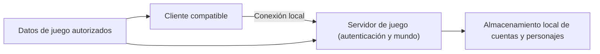

# Arquitectura provisional

Estado a 22 de noviembre de 2026. El laboratorio EP8 usa ArchCore con MariaDB y Archonia x64 parche `665`. La combinación para Codemasters EP3 sigue en estudio.

## Despliegue local

Usar un equipo de desarrollo con Windows y un mundo de prueba. Emplear la configuración con el menor número de procesos que admita el servidor elegido. La autenticación y el mundo son responsabilidades distintas que pueden ejecutarse en el mismo proceso. Usar el motor de almacenamiento y el esquema que admita la revisión seleccionada.

| Decisión | Estado y justificación |
| --- | --- |
| Primer despliegue | Un equipo y un mundo. Escuchar en la interfaz de bucle local cuando el servidor lo permita. Así se puede probar la compatibilidad con independencia del alojamiento. Antes de dar por válida una ejecución local, comprobar las interfaces y los puertos en escucha y los destinos a los que se conecta el lanzador. |
| Referencia clásica | Propuesta pendiente de aprobación. Episodio 3 de Codemasters, *Spirits Awakening*, antes del traspaso a Webzen en octubre de 2009. La fidelidad al contenido y la compatibilidad con el ejecutable son comprobaciones distintas. |
| Laboratorio EP8 | ArchCore `ad280a6` compila en Windows x64 y arranca login y mundo con MariaDB `11.4.14` y un esquema limpio. La prueba verificó las escuchas en bucle local. La elección de una base para EP3 sigue pendiente de una pareja cliente-servidor reproducible y de permisos verificables. [Resultado del laboratorio](ARCHCORE_LOCAL_SERVER.md) · [Viabilidad técnica de EP3](EP3_SERVER_FEASIBILITY.md) |
| Pareja cliente-servidor EP8 | Adoptada para el laboratorio. ArchCore `ad280a6`, MariaDB `11.4.14` y Archonia x64 parche `665` permitieron autenticarse, crear un Knight en la interfaz y entrar a la escena original. La elección se revisará si la validación de movimiento o las condiciones de uso impiden continuar con el cliente. [Sesión manual persistente](ARCHCORE_GRAPHICAL_CLIENT.md#sesión-manual-persistente-del-parche-665) |
| Herramientas propias | TypeScript es una opción si la instalación requiere herramientas propias. Considerar Angular cuando haya un caso de uso concreto para una interfaz web. El primer hito se puede completar sin ella. |
| Archivos locales | Mantener los archivos y datos autorizados del cliente fuera de la copia de trabajo siempre que sea posible. Si se necesita una ruta en el espacio de trabajo, usar el directorio excluido `.local/` para preparar archivos locales y guardar el estado de ejecución y los archivos de depuración. Mantener en Git los ejemplos de configuración y las migraciones del esquema propias del proyecto para poder revisarlos. |
| Fuentes del laboratorio EP8 | `server/archcore` es un submódulo de `BlaMacfly/ArchCore` fijado a `ad280a6`. El Git principal registra el gitlink y el Git de ArchCore conserva su propio historial. El checkout parcial materializa Rust, manifiestos y SQL revisado. La configuración, MariaDB y los binarios se mantienen en el laboratorio externo. [Estructura e inicialización](ARCHCORE_LOCAL_SERVER.md#fuentes-en-el-repositorio-principal) |
| Regreso a selección EP8 | Validado con Archonia x64 `665`. La integración en el repositorio principal mantiene el pin actual y aporta parches aplicables a una copia aislada, con una regresión reproducible. Priorizar una aportación upstream antes de actualizar el gitlink. Evaluar un repositorio propio cuando EP3 requiera cambios recurrentes o upstream no pueda incorporar el arreglo. Revisar la licencia y la procedencia del contenido que quedaría accesible antes de publicar una derivación. [Prueba gráfica](ARCHCORE_GRAPHICAL_CLIENT.md#validación-gráfica-del-regreso-a-selección) · [Integración](ARCHCORE_RETURN_INTEGRATION.md) |
| Transferencia de Login a World | Validada con Archonia x64 `665` en el laboratorio instrumentado y con una compilación nueva. El parche conserva el socket anterior durante tres segundos con las solicitudes de aplicación desactivadas. Mantener una regresión TCP del orden y el cierre, más el recorrido gráfico de cinco minutos. Revisar el plazo si otra compilación del cliente vuelve a mostrar el aviso o si llegan transferencias de World más lentas. [Evidencia y reproducción](EP8_AUTONOMOUS_PROGRESS.md) |
| Contenido para la prueba de jugabilidad EP8 | Adoptado para el siguiente ensayo. Reutilizar el motor de ArchCore y aprovisionar un sector de Anchorville en una MariaDB desechable, con la procedencia y la revisión de sus datos verificadas por separado. La auditoría comprobó los paquetes de aparición, diálogo, combate, progresión y Gold con datos sintéticos. Validar el modelo y el diálogo de un NPC y la aparición de un mob con `665` antes de ampliar el catálogo. Revisar implementación o protocolo cuando un caso con TID, terreno y datos comprobados falle. [Auditoría de jugabilidad](ARCHCORE_GAMEPLAY_AUDIT.md) |

## Resultados de la investigación

- El anuncio de Webzen de octubre de 2009 confirma que asumió el alojamiento en Europa y Norteamérica al vencer la licencia de Codemasters. Webzen recoge ArchLord 2 por separado en su historia corporativa. El objetivo de este proyecto es el ArchLord original. [Anuncio del servicio de Webzen](https://company.webzen.com/en/pr/pressview?page=81&seq=274), [Historia corporativa de Webzen](https://company.webzen.com/en/about/history)
- Sigue sin confirmarse a partir de las fuentes públicas consultadas que el titular de los derechos haya publicado un servidor de ArchLord para alojarlo por cuenta propia o haya autorizado la obtención y reutilización del cliente y los datos correspondientes. Los anuncios históricos de publicación se refieren a la operación del servicio de Webzen. [Anuncio de publicación de Webzen](https://company.webzen.com/en/pr/pressview?page=4&searchText=summer&seq=272)
- **ArchCore** se conserva como alternativa para una prueba técnica. Sus responsables lo describen como un emulador en Rust con MariaDB, bajo GPL-3.0-or-later, dirigido al cliente Archonia de 64 bits y al contenido del episodio 8 con extensiones de Archonia. Informan de pruebas de inicio de sesión y entrada al mundo con el cliente y distinguen esas pruebas de las funciones probadas solo en su simulador. La instalación documentada también requiere archivos del cliente y usa tablas del servidor y un mapa incluidos en el repositorio. Verificar la procedencia y las condiciones de uso de cada archivo por separado de la licencia del código. [Repositorio de ArchCore](https://github.com/BlaMacfly/ArchCore)
- **ArchRust** documenta un modo que usa recursos de sustitución cuando faltan los originales. Sigue pendiente verificar una entrada completa al mundo con datos íntegramente de creación propia. **ArchHome** documenta una instalación para un solo jugador que usa ArchRust y datos del juego que aporta el usuario. Su lanzador y sus scripts tienen una licencia propietaria. La documentación describe las tablas incluidas del episodio 8 como tablas originales del servidor, por lo que su procedencia y sus condiciones requieren una revisión específica de viabilidad. [Repositorio de ArchRust](https://github.com/BlaMacfly/ArchRust), [Repositorio de ArchHome](https://github.com/BlaMacfly/ArchHome)
- **ALEmu** figura en GitHub con la etiqueta de licencia GPL-3.0 y se archivó en mayo de 2022. Su README lo describe como un proyecto en desarrollo. Sigue pendiente verificar que permita jugar en un mundo local. **osiy1996/archlord** documenta una compilación para Windows y el uso de PostgreSQL 9.6, cuyo soporte terminó en 2021. La página del repositorio no acredita una licencia de reutilización. **ArchSvrCalidus** indica que usa archivos originales del servidor y enumera ejecutables reempaquetados. Se excluyen esos binarios de la prueba local porque su procedencia y sus derechos están pendientes de verificación. [Repositorio de ALEmu](https://github.com/CoolManBob/ALEmu), [Repositorio de osiy1996/archlord](https://github.com/osiy1996/archlord), [Última versión de PostgreSQL 9.6](https://www.postgresql.org/about/news/postgresql-141-135-129-1114-1019-and-9624-released-2349/), [Repositorio de ArchSvrCalidus](https://github.com/fiercerich/ArchSvrCalidus)

La [investigación del servidor clásico](CLASSIC_SERVER_RESEARCH.md) detalla la edición binaria de Alcadia EP3, su diferencia con el repositorio público de osiy1996 y la comparación con la alternativa moderna. Sigue pendiente reproducir un arranque de EP3 en Windows con código y datos autorizados.

## Requisitos de viabilidad local

| Pregunta abierta | Evidencia necesaria |
| --- | --- |
| ¿Cuál es el cliente exacto? | Versión o episodio, región, identificador de compilación, arquitectura de CPU, procedencia y huella SHA-256 de una copia local autorizada. Identificar los requisitos del lanzador, del actualizador y del entorno de ejecución. |
| ¿Qué archivos se pueden usar? | Inventario breve del cliente, los recursos del juego, el código del servidor y las tablas o mapas necesarios, con la procedencia, la versión y las condiciones de cada elemento. Registrar por separado los permisos de uso local y los de una posible redistribución. |
| ¿Qué revisión del servidor es compatible con ese cliente? | Revisión exacta del proyecto de origen, compilaciones documentadas como compatibles, funciones disponibles para la primera zona jugable y evidencia de la prueba más reciente de conexión entre cliente y servidor. |
| ¿Qué debe ejecutarse en local? | Versiones compatibles de Windows y de las herramientas de compilación, fuentes de las dependencias, orden de arranque, direcciones y puertos de escucha, y requisitos de conexión saliente del lanzador o del actualizador. Confirmar un método admitido para dirigir el cliente a la interfaz de bucle local. |
| ¿Cómo se inicializan las cuentas y el estado del mundo? | Versión requerida de la base de datos, inicialización del esquema desde cero, creación de una cuenta con datos de prueba ficticios, datos del mundo necesarios, comportamiento del guardado entre reinicios e instrucciones para recrear el estado de prueba. |
| ¿Qué demuestra la compatibilidad? | Evidencia documentada del inicio de sesión, la selección de mundo si corresponde, la selección o creación de personaje, la entrada al mundo, el movimiento y la persistencia del estado después de reiniciar. Registrar con los resultados la revisión del servidor y la huella del cliente. |

## Próxima decisión

Tras la revisión de los parches de regreso a selección en `develop`, repetir el recorrido EP8 desde una instalación limpia con recuperación de la posición después de reiniciar el servidor. Tras estabilizar EP8, evaluar adaptaciones hacia EP3 cuando se haya identificado una compilación de Codemasters para uso local autorizado y una base compatible. [Integración del retorno](ARCHCORE_RETURN_INTEGRATION.md) · [Ensayo gráfico de EP8](ARCHCORE_GRAPHICAL_CLIENT.md)
