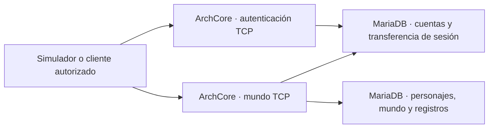

# Viabilidad de un servidor ArchLord EP3 en Windows

Análisis del 21 de noviembre de 2026. La referencia de producto es Codemasters EP3, *Spirits Awakening* (2008–2009). Este informe amplía la [investigación histórica](CLASSIC_SERVER_RESEARCH.md) mediante la lectura de archivos públicos en revisiones concretas. Se comprobó lo que declaran los proyectos de compilación y se siguieron rutas de código. Compilación y ejecución siguen pendientes.

## Resumen ejecutivo

**La recomendación es evaluar ArchCore como base técnica de laboratorio. La elección de un servidor para Codemasters EP3 sigue pendiente.** ArchCore ofrece código de servidor en Rust, dependencias fijadas, un esquema inicial con migraciones y un binario que reúne herramientas, autenticación y mundo. Su pareja documentada es Archonia de 64 bits sobre EP8 con ArchRust como cliente alternativo. Entre los candidatos revisados, ninguno reúne a la vez fuentes modificables con permiso verificable, arranque reproducible y una compilación de Codemasters EP3 acreditada. [Manifiesto de ArchCore](https://github.com/BlaMacfly/ArchCore/blob/ad280a6efc069526fc58445e5397d52a0e809500/Cargo.toml) · [Episodio y cliente de referencia](https://github.com/BlaMacfly/ArchCore/blob/ad280a6efc069526fc58445e5397d52a0e809500/docs/wiki/EN-Episode.md) · [Cliente ArchRust](https://github.com/BlaMacfly/ArchRust/blob/256888eb123063e21711bde98f9572c44fed5bee/README.en.md)

El hallazgo determinante sobre Osiy está en el código. El servidor público exige que el cliente anuncie la versión de protocolo `13.0`. Falta asociar ese par de números a una compilación autorizada de Codemasters EP3. El repositorio público no acredita licencia de modificación y la edición Alcadia EP3 anunciada por el autor es un paquete distinto, publicado con un volcado de cuentas. ALEmu sí tiene licencia visible, pero su publicación identifica un cliente EP8 y describe el alcance de un sandbox. [Comprobación de versión](https://github.com/osiy1996/archlord/blob/415fe892f1241ee09b9292f5bd08efb8b944012f/source/server/as_login.c#L264-L279) · [Constantes de versión](https://github.com/osiy1996/archlord/blob/415fe892f1241ee09b9292f5bd08efb8b944012f/source/server/as_login.c#L29-L30) · [Anuncio de Alcadia](https://www.elitepvpers.com/forum/archlord/5167240-release-emulator-editor-5.html) · [ALEmu EP8 Sandbox Update](https://github.com/CoolManBob/ALEmu/releases/tag/EP8SandboxUpdate)

## Comparativa de candidatos

**Código** significa que existe una ruta de ejecución identificada en los archivos revisados. **Publicado** significa que un autor lo describe o comunica una prueba. **Pendiente** requiere reproducirlo en una revisión y un entorno identificados. La dificultad califica la primera conexión local, con permiso y dependencias resueltos.

| Candidato y revisión | Implementación, Windows y base de datos | Cliente, alcance y decisión |
| --- | --- | --- |
| **ArchCore** `ad280a6` | Fuente Rust, Tokio, `mysql_async`, dos crates y un ejecutable. Cargo declara Rust 1.85 como mínimo y el repositorio conserva `Cargo.lock`. Windows está documentado. MariaDB y cuatro esquemas lógicos. El autor declara GPL-3.0-or-later para el código. | Archonia x64 y EP8 documentados. Hay rutas de autenticación, personaje y mundo y un simulador. Construcción y primer arranque con esquema limpio por reproducir. Dificultad media para el laboratorio, alta e indeterminada para portar a EP3. **Evaluar primero.** [Cargo.toml](https://github.com/BlaMacfly/ArchCore/blob/ad280a6efc069526fc58445e5397d52a0e809500/Cargo.toml) · [Entrada](https://github.com/BlaMacfly/ArchCore/blob/ad280a6efc069526fc58445e5397d52a0e809500/crates/archcore/src/main.rs#L41-L68) · [Base de datos](https://github.com/BlaMacfly/ArchCore/blob/ad280a6efc069526fc58445e5397d52a0e809500/crates/archcore/src/db.rs#L96-L127) · [Declaración de licencia](https://github.com/BlaMacfly/ArchCore/blob/ad280a6efc069526fc58445e5397d52a0e809500/README.md#license) |
| **ArchRust** `256888e` | Fuente de cliente Rust, Tokio, winit, wgpu y egui, con Lua integrado mediante mlua. Objetivo `x86_64-pc-windows-msvc`, con `target-cpu=x86-64-v2`. Sin base de datos propia. La licencia declara GPL-3.0-or-later para el código y delimita los recursos de terceros. | Código de conexión, selección y entrada al mundo frente a ArchCore. La modalidad gráfica usa datos Archonia. Existe un modo con sustitutos visuales cuya suficiencia para una sesión completa con datos propios queda pendiente. Dificultad media en modo sin interfaz una vez que haya servidor funcional. **Cliente de segunda etapa.** [Manifiesto](https://github.com/BlaMacfly/ArchRust/blob/256888eb123063e21711bde98f9572c44fed5bee/Cargo.toml) · [Objetivo y CPU](https://github.com/BlaMacfly/ArchRust/blob/256888eb123063e21711bde98f9572c44fed5bee/.cargo/config.toml) · [Toolchain](https://github.com/BlaMacfly/ArchRust/blob/256888eb123063e21711bde98f9572c44fed5bee/rust-toolchain.toml) · [Licencia](https://github.com/BlaMacfly/ArchRust/blob/256888eb123063e21711bde98f9572c44fed5bee/LICENSE.md) · [Datos que aporta el usuario](https://github.com/BlaMacfly/ArchRust/blob/256888eb123063e21711bde98f9572c44fed5bee/docs/ASSETS-NON-FOURNIS.en.md) |
| **osiy1996/archlord** `415fe89` | Fuente de servidor C con módulos propios, WinSock y libpq. Solución x64 y proyecto de servidor separado del editor. Windows SDK 10.0 y MSVC v143. Enlaza `libpq.lib`, `libeay32.lib` y `ws2_32.lib`. El README pide PostgreSQL 9.6. La raíz y los metadatos consultados carecen de licencia de reutilización identificada. | El código verifica protocolo `13.0` y contiene autenticación, personajes, mundo, movimiento y persistencia. No hay correspondencia acreditada con un ejecutable Codemasters EP3. El autor enumera carencias de IA, habilidades, gremios y asedios. Dificultad alta por licencia, cliente y ABI de dependencias. **Mantener como referencia de análisis.** [Proyecto de servidor](https://github.com/osiy1996/archlord/blob/415fe892f1241ee09b9292f5bd08efb8b944012f/msvc/projects/server/server.vcxproj#L19-L40) · [Enlaces de Release](https://github.com/osiy1996/archlord/blob/415fe892f1241ee09b9292f5bd08efb8b944012f/msvc/projects/server/server.vcxproj#L106-L122) · [estado funcional](https://github.com/osiy1996/archlord/blob/415fe892f1241ee09b9292f5bd08efb8b944012f/status.md) · [Metadatos del repositorio público](https://github.com/osiy1996/archlord) |
| **ALEmu** `0411ada` | C++ con aplicaciones separadas AlefLogin y AlefWorld, biblioteca AlefCommon y POCO. Solución con x64, proyectos v143/SDK 10.0 y bibliotecas precompiladas. Conector POCO Data MySQL y esquema publicado para MySQL 8.0.20. Código con GPL-3.0 en GitHub. Archivado. | La release acredita una prueba de sandbox con EP8 según el autor. La release anterior describía un personaje de prueba, credenciales simuladas y movimiento básico. El manejador de movimiento optimizado inspeccionado tiene su procesamiento comentado. Dificultad alta. **Excluir de la prueba EP3 actual.** [proyecto Windows](https://github.com/CoolManBob/ALEmu/blob/0411ada9d7d16109ad60ae162662e19e639cd350/AlefLogin/AlefLogin.vcxproj) · [conector MySQL](https://github.com/CoolManBob/ALEmu/blob/0411ada9d7d16109ad60ae162662e19e639cd350/AlefCommon/AlefDBInterface.cpp#L5-L29) · [cabecera de esquema MySQL](https://github.com/CoolManBob/ALEmu/blob/0411ada9d7d16109ad60ae162662e19e639cd350/sql/alemulogin.sql#L1-L5) · [manejador incompleto](https://github.com/CoolManBob/ALEmu/blob/0411ada9d7d16109ad60ae162662e19e639cd350/AlefWorld/AlefWorldOptimizedCharMove.cpp#L4-L22) · [Releases de ALEmu](https://github.com/CoolManBob/ALEmu/releases) |
| **ArchHome** `2677266` | Lanzador Rust para Windows, scripts PowerShell, ArchCore, ArchRust y MariaDB portátil. El lanzador y los scripts tienen licencia propietaria, con condiciones propias para los componentes separados. | Paquete de escritorio para un jugador que usa ArchRust y datos EP8. Su lanzador aporta una referencia de operación offline. Dificultad media como producto empaquetado. **Descartar como base modificable para EP3.** [construcción en Windows](https://github.com/BlaMacfly/ArchHome/blob/26772667d52b9f92289033dac080fa7e17d16836/Documentation/02-Construction.md) · [términos](https://github.com/BlaMacfly/ArchHome/blob/26772667d52b9f92289033dac080fa7e17d16836/LICENCE.txt) · [componentes y datos requeridos](https://github.com/BlaMacfly/ArchHome/blob/26772667d52b9f92289033dac080fa7e17d16836/README.md) |
| **Alcadia EP3 y ArchSvrCalidus** | El primero anuncia un binario EP3 comunitario para Windows con PostgreSQL 9.6 y un volcado. El segundo publica binarios reempaquetados, configuración y scripts para un entorno Oracle y Visual C++ heredado. Falta una revisión de servidor con fuentes, dependencias y permiso acreditados para esas distribuciones. | La etiqueta EP3 y los testimonios de compatibilidad se refieren a ediciones o clientes privados. No hay evidencia reproducible para el cliente objetivo. Dificultad alta con riesgo de procedencia. **Excluir de la ejecución.** [Anuncio de Alcadia EP3](https://www.elitepvpers.com/forum/archlord/5167240-release-emulator-editor-5.html) · [Árbol y README de Calidus](https://github.com/fiercerich/ArchSvrCalidus) |

En la consulta de ramas y etiquetas, Osiy solo publicaba `main` y `v0.0.1`, descrita como una primera versión de servidor. En ArchCore aparecían `Core`, `archbot` y las etiquetas `v0.1.0` y `v0.2.0`. Esta última marca la transición de Node.js a Rust. Elegir la revisión fijada evita mezclar instrucciones de ambos diseños. [Release de Osiy](https://github.com/osiy1996/archlord/releases/tag/v0.0.1) · [ArchCore v0.1.0](https://github.com/BlaMacfly/ArchCore/releases/tag/v0.1.0) · [ArchCore v0.2.0](https://github.com/BlaMacfly/ArchCore/releases/tag/v0.2.0)

## Arquitectura y evidencia en código

### ArchCore, candidato para el laboratorio

| Área | Confirmado en la revisión de código | Alcance que falta verificar |
| --- | --- | --- |
| Arranque y configuración | `main` despacha `login`, `world`, `all`, `db-init`, `db-check`, `sim` y `--help`. `server.rs` carga configuración, plantillas y catálogos, verifica versiones de esquema y abre los servicios que correspondan. Puede hacerlo en un solo proceso. [entrada](https://github.com/BlaMacfly/ArchCore/blob/ad280a6efc069526fc58445e5397d52a0e809500/crates/archcore/src/main.rs#L41-L68) · [arranque y mundo](https://github.com/BlaMacfly/ArchCore/blob/ad280a6efc069526fc58445e5397d52a0e809500/crates/archcore/src/server.rs#L8-L122) | Compilación, arranque y lectura correcta de los archivos `.conf` en Windows con la revisión fijada. |
| Red y observación | TCP con Tokio. Los ejemplos ponen autenticación en 11002 y mundo en 11008. Los dos `Bind` de ejemplo están en `0.0.0.0`, mientras que `PublicAddress` anuncia el mundo por separado. `log.rs` escribe a consola con fecha y nivel. El servicio auxiliar SOAP se abre si está habilitado. [red TCP](https://github.com/BlaMacfly/ArchCore/blob/ad280a6efc069526fc58445e5397d52a0e809500/crates/archcore/src/net.rs) · [auth.conf.dist](https://github.com/BlaMacfly/ArchCore/blob/ad280a6efc069526fc58445e5397d52a0e809500/config/auth.conf.dist#L34-L40) · [world.conf.dist](https://github.com/BlaMacfly/ArchCore/blob/ad280a6efc069526fc58445e5397d52a0e809500/config/world.conf.dist#L42-L63) · [registros](https://github.com/BlaMacfly/ArchCore/blob/ad280a6efc069526fc58445e5397d52a0e809500/crates/archcore/src/log.rs#L15-L37) · [SOAP opcional](https://github.com/BlaMacfly/ArchCore/blob/ad280a6efc069526fc58445e5397d52a0e809500/crates/archcore/src/server.rs#L112-L118) | Acreditar las interfaces, los puertos efectivos y los destinos del cliente. En la prueba, usar `127.0.0.1` explícito en ambos escuchadores y en el anuncio del mundo. |
| Autenticación y sesión | El manejador consulta la cuenta y comprueba la contraseña. La selección emite un token de transición, lo guarda en MariaDB y el mundo lo consume al aceptar la sesión. [comprobación de cuenta](https://github.com/BlaMacfly/ArchCore/blob/ad280a6efc069526fc58445e5397d52a0e809500/crates/archcore/src/login.rs#L257-L290) · [transferencia al mundo](https://github.com/BlaMacfly/ArchCore/blob/ad280a6efc069526fc58445e5397d52a0e809500/crates/archcore/src/login.rs#L552-L583) · [consumo del token](https://github.com/BlaMacfly/ArchCore/blob/ad280a6efc069526fc58445e5397d52a0e809500/crates/archcore/src/world/mod.rs#L695-L719) | Resultado de una cuenta ficticia y de un intento con contraseña incorrecta. La existencia de esta ruta no demuestra que un cliente antiguo pueda usarla. |
| Persistencia | `mysql_async` implementa consultas y transacciones, con pools lógicos de cuentas, personajes, mundo y registros. `build.rs` incorpora el SQL base y las migraciones al compilar. `db-init` inicializa y opcionalmente crea una cuenta. `db-check` consulta versiones y coherencia en modo de lectura. [persistencia](https://github.com/BlaMacfly/ArchCore/blob/ad280a6efc069526fc58445e5397d52a0e809500/crates/archcore/src/db.rs#L64-L119) · [SQL incorporado](https://github.com/BlaMacfly/ArchCore/blob/ad280a6efc069526fc58445e5397d52a0e809500/crates/archcore/build.rs#L16-L35) · [inicialización](https://github.com/BlaMacfly/ArchCore/blob/ad280a6efc069526fc58445e5397d52a0e809500/crates/archcore/src/tools/db_init.rs) · [diagnóstico de base](https://github.com/BlaMacfly/ArchCore/blob/ad280a6efc069526fc58445e5397d52a0e809500/crates/archcore/src/tools/db_check.rs) | Revisar el SQL que se incorporará y demostrar que el esquema parte de cero. La validez del esquema es independiente de que existan plantillas y datos del mundo. |
| Personajes, mundo y movimiento | El login lista personajes e inserta uno con su plantilla y posición. El mundo valida la sesión, carga el estado y enruta movimiento a `presence::on_move`. Hay código de combate y un simulador que recorre la conexión y la selección. [lista](https://github.com/BlaMacfly/ArchCore/blob/ad280a6efc069526fc58445e5397d52a0e809500/crates/archcore/src/login.rs#L353-L362) · [creación](https://github.com/BlaMacfly/ArchCore/blob/ad280a6efc069526fc58445e5397d52a0e809500/crates/archcore/src/login.rs#L440-L467) · [movimiento](https://github.com/BlaMacfly/ArchCore/blob/ad280a6efc069526fc58445e5397d52a0e809500/crates/archcore/src/world/mod.rs#L565-L580) · [entrada](https://github.com/BlaMacfly/ArchCore/blob/ad280a6efc069526fc58445e5397d52a0e809500/crates/archcore/src/world/mod.rs#L897-L947) · [combate](https://github.com/BlaMacfly/ArchCore/blob/ad280a6efc069526fc58445e5397d52a0e809500/crates/archcore/src/world/combat.rs) · [flujo del simulador](https://github.com/BlaMacfly/ArchCore/blob/ad280a6efc069526fc58445e5397d52a0e809500/crates/archcore/src/tools/sim.rs#L619-L686) | El autor publica autenticación, entrada, movimiento y posición guardada con el cliente de referencia. Combate, visibilidad mutua y varias funciones sociales siguen descritos como comprobados en simulador o pendientes de juego real. Hace falta demostrar un personaje válido con datos permitidos. [estado publicado de las pruebas](https://github.com/BlaMacfly/ArchCore/blob/ad280a6efc069526fc58445e5397d52a0e809500/docs/wiki/EN-Roadmap.md) |

### Osiy, ALEmu y ArchRust

- **Osiy.** Un `main` nativo registra módulos C y procesa red, tareas de base de datos, personajes, cuentas, gremios y apariciones. Antes de abrir las escuchas carga datos del mundo, prepara plantillas y conecta PostgreSQL. El archivo `config` propone TCP 11002 y 11008, con direcciones de LAN de ejemplo. Incluye parámetros para HTTP en 8080 y el bucle consulta peticiones HTTP. PostgreSQL se conecta mediante libpq sin dirección explícita en esa cadena. Los logs usan salida estándar y de error. [secuencia de arranque](https://github.com/osiy1996/archlord/blob/415fe892f1241ee09b9292f5bd08efb8b944012f/source/server/main.c#L698-L727) · [bucle principal](https://github.com/osiy1996/archlord/blob/415fe892f1241ee09b9292f5bd08efb8b944012f/source/server/main.c#L758-L805) · [configuración](https://github.com/osiy1996/archlord/blob/415fe892f1241ee09b9292f5bd08efb8b944012f/config#L1-L10) · [escuchadores](https://github.com/osiy1996/archlord/blob/415fe892f1241ee09b9292f5bd08efb8b944012f/source/server/as_server.c#L242-L274) · [conexión libpq](https://github.com/osiy1996/archlord/blob/415fe892f1241ee09b9292f5bd08efb8b944012f/source/server/as_database.c#L104-L121) · [logs](https://github.com/osiy1996/archlord/blob/415fe892f1241ee09b9292f5bd08efb8b944012f/source/core/log.c#L39-L69)
- **Funciones de Osiy.** El login comprueba versión, etapas de autenticación y credenciales. Las cuentas se cargan y guardan mediante consultas preparadas. La entrada usa una autorización del login y añade el personaje al registro de jugadores y al mapa. El módulo de personajes contiene lógica de desplazamiento. Esta evidencia y la ausencia de licencia se refieren a `415fe89`. El estado publicado distingue funciones parciales y carencias como castillos, asedios y la batalla por el título. [flujo de login](https://github.com/osiy1996/archlord/blob/415fe892f1241ee09b9292f5bd08efb8b944012f/source/server/as_login.c#L150-L192) · [consultas de cuenta](https://github.com/osiy1996/archlord/blob/415fe892f1241ee09b9292f5bd08efb8b944012f/source/server/as_account.c#L124-L158) · [entrada al mapa](https://github.com/osiy1996/archlord/blob/415fe892f1241ee09b9292f5bd08efb8b944012f/source/server/as_game_admin.c#L342-L405) · [movimiento](https://github.com/osiy1996/archlord/blob/415fe892f1241ee09b9292f5bd08efb8b944012f/source/server/as_character_process.c#L63-L168) · [carencias declaradas](https://github.com/osiy1996/archlord/blob/415fe892f1241ee09b9292f5bd08efb8b944012f/status.md#L32-L49)
- **ALEmu.** Hay dos puntos de entrada, autenticación, configuración de base y un despachador de operaciones de personajes y mundo. La release `Sandbox` describe un binario con login de prueba y movimiento como único objetivo. La release posterior indica EP8, así que esa ejecución publicada tampoco sirve para validar EP3. El código actual tiene una ruta optimizada de movimiento incompleta. [entrada de autenticación](https://github.com/CoolManBob/ALEmu/blob/0411ada9d7d16109ad60ae162662e19e639cd350/AlefLogin/main.cpp) · [entrada de mundo](https://github.com/CoolManBob/ALEmu/blob/0411ada9d7d16109ad60ae162662e19e639cd350/AlefWorld/main.cpp) · [operaciones de personaje](https://github.com/CoolManBob/ALEmu/blob/0411ada9d7d16109ad60ae162662e19e639cd350/AlefLogin/AlefLoginClientLogin.cpp#L74-L100) · [puertos configurados](https://github.com/CoolManBob/ALEmu/blob/0411ada9d7d16109ad60ae162662e19e639cd350/out/AlefLogin.ini#L2-L23) · [Releases de ALEmu](https://github.com/CoolManBob/ALEmu/releases)
- **ArchRust.** La aplicación admite modo sin cliente instalado y tiene código de red para autenticación y mundo. El modo con interfaz añade requisitos de GPU y controladores que no afectan a la primera prueba con el simulador del servidor. Un archivo de configuración documentado permite apuntar ArchRust al bucle local. La capacidad de iniciar una sesión completa con sustitutos de sus recursos queda por medir. [opciones de arranque](https://github.com/BlaMacfly/ArchRust/blob/256888eb123063e21711bde98f9572c44fed5bee/apps/archrust/src/main.rs#L24-L56) · [autenticación del cliente](https://github.com/BlaMacfly/ArchRust/blob/256888eb123063e21711bde98f9572c44fed5bee/crates/archrust-netclient/src/login.rs) · [conexión al mundo](https://github.com/BlaMacfly/ArchRust/blob/256888eb123063e21711bde98f9572c44fed5bee/crates/archrust-netclient/src/world.rs) · [apuntado del cliente](https://github.com/BlaMacfly/ArchRust/blob/256888eb123063e21711bde98f9572c44fed5bee/README.en.md#installing-beside-the-client-and-realmlistwtf)

## Herramientas y requisitos para Windows

| Componente | Qué preparar tras la autorización | Evidencia y puntos abiertos |
| --- | --- | --- |
| Laboratorio ArchCore | Windows 11 x64, rustup y Cargo para `x86_64-pc-windows-msvc`, Build Tools de Visual Studio con C++ de escritorio, MSVC y un Windows SDK compatible. Fijar la versión de Rust usada y conservar `Cargo.lock`. | `rust-version = 1.85` declara el mínimo del workspace. La versión efectiva debe comprobarse con el lockfile y la compilación. Rust documenta Windows 10+ para MSVC. Para un laboratorio nuevo, Windows 11 evita partir de Windows 10 22H2, cuyo soporte ordinario terminó en 2025. [workspace](https://github.com/BlaMacfly/ArchCore/blob/ad280a6efc069526fc58445e5397d52a0e809500/Cargo.toml) · [Objetivo MSVC de Rust](https://doc.rust-lang.org/rustc/platform-support/windows-msvc.html) · [Requisitos de Visual Studio](https://learn.microsoft.com/en-us/visualstudio/releases/2022/system-requirements) · [Ciclo de vida de Windows 10](https://learn.microsoft.com/en-us/lifecycle/announcements/windows-10-end-of-support) |
| Base de ArchCore | Una instancia MariaDB x64 en bucle local, con usuario de laboratorio y esquema nuevo. MariaDB 11.4 LTS es la propuesta inicial de prueba. Fijar el parche y verificar migraciones antes de probar un cliente. | La guía upstream indica 10.6 o superior y su lanzador de ejemplo fija una ruta a 13.0. El proyecto MariaDB dio por terminada la rama 10.6 en 2026. No se ha comprobado el funcionamiento de 11.4 con esta revisión. [documentación de instalación de ArchCore](https://github.com/BlaMacfly/ArchCore/blob/ad280a6efc069526fc58445e5397d52a0e809500/docs/wiki/EN-Installation.md) · [lanzador de ejemplo](https://github.com/BlaMacfly/ArchCore/blob/ad280a6efc069526fc58445e5397d52a0e809500/db/start-mariadb.cmd) · [Mantenimiento oficial de MariaDB en 2026](https://mariadb.org/mariadb-server-12-3-11-8-11-4-and-10-11-q4-2026-maintenance-releases/) |
| ArchRust opcional | Mismo entorno MSVC x64 y CPU compatible con x86-64-v2. Si se usa modo gráfico, verificar GPU y controladores para wgpu. | El toolchain apunta a `stable`, así que se registrará la versión que resuelva. El script usa el compilador de recursos del SDK para icono y metadatos, y tolera que falle ese paso. [toolchain](https://github.com/BlaMacfly/ArchRust/blob/256888eb123063e21711bde98f9572c44fed5bee/rust-toolchain.toml) · [opciones del compilador](https://github.com/BlaMacfly/ArchRust/blob/256888eb123063e21711bde98f9572c44fed5bee/.cargo/config.toml) · [recursos de Windows](https://github.com/BlaMacfly/ArchRust/blob/256888eb123063e21711bde98f9572c44fed5bee/apps/archrust/build.rs) · [motor gráfico](https://github.com/BlaMacfly/ArchRust/blob/256888eb123063e21711bde98f9572c44fed5bee/crates/archrust-engine/Cargo.toml) |
| Osiy y ALEmu, si se reevalúan | MSVC v143, proyecto x64 y SDK Windows 10.0. Osiy necesita resolver libpq, la biblioteca OpenSSL heredada y sus DLL compatibles. ALEmu exige las bibliotecas POCO y el conector MySQL compatibles con el objetivo x64. Revisar versiones del runtime de C/C++ y ABI antes de usar artefactos precompilados. | Que Build Tools compile en Windows 10/11 no establece que estas dependencias legadas funcionen allí. PostgreSQL 9.6 está fuera de soporte y no se ha probado un PostgreSQL mantenido con Osiy. Los dumps SQL de ALEmu describen su esquema histórico. Para probarlo haría falta un esquema revisado y limpio. [proyecto Windows](https://github.com/osiy1996/archlord/blob/415fe892f1241ee09b9292f5bd08efb8b944012f/msvc/projects/server/server.vcxproj) · [proyecto de mundo](https://github.com/CoolManBob/ALEmu/blob/0411ada9d7d16109ad60ae162662e19e639cd350/AlefWorld/AlefWorld.vcxproj) · [Versionado de PostgreSQL](https://www.postgresql.org/support/versioning/) |

## Riesgos técnicos y de derechos

- **Compatibilidad.** Editor, región, arquitectura del cliente, revisión, protocolo declarado y SHA-256 se verifican por separado. Compilar el servidor x64 no fija la arquitectura del cliente ni demuestra interoperabilidad. La revisión de Osiy rechaza versiones distintas de `13.0`. ArchCore y ALEmu publican evidencia EP8. [validación de versión](https://github.com/osiy1996/archlord/blob/415fe892f1241ee09b9292f5bd08efb8b944012f/source/server/as_login.c#L264-L279) · [versión de referencia](https://github.com/BlaMacfly/ArchCore/blob/ad280a6efc069526fc58445e5397d52a0e809500/docs/wiki/EN-Episode.md) · [ALEmu EP8](https://github.com/CoolManBob/ALEmu/releases/tag/EP8SandboxUpdate)
- **Código y datos.** Conservar registro por componente de licencia, titular o procedencia, revisión, datos requeridos y uso autorizado. La GPL del código no resuelve los derechos del cliente, mapas, tablas, audio o bibliotecas redistribuidas. ArchCore documenta tablas y mapas EP8 y su instalación habitual requiere datos del cliente. Revisar aparte el SQL que el compilador embebe. Excluir volcados de terceros, binarios de procedencia incierta y datos cuyo permiso no se pueda acreditar. [origen de tablas y mapa](https://github.com/BlaMacfly/ArchCore/blob/ad280a6efc069526fc58445e5397d52a0e809500/docs/wiki/EN-Installation.md#4-import-the-client-data) · [SQL incorporado en compilación](https://github.com/BlaMacfly/ArchCore/blob/ad280a6efc069526fc58445e5397d52a0e809500/crates/archcore/build.rs) · [GitHub sobre licencias de código](https://docs.github.com/en/repositories/managing-your-repositorys-settings-and-features/customizing-your-repository/licensing-a-repository)
- **Aislamiento.** Usar configuración de laboratorio, cuenta ficticia y base separada. Comprobar tanto `Bind` como dirección anunciada. Mantener SOAP y servicios web auxiliares desactivados para esta prueba, y conservar los registros fuera de Git. [configuración de red y servicios](https://github.com/BlaMacfly/ArchCore/blob/ad280a6efc069526fc58445e5397d52a0e809500/docs/wiki/EN-Configuration.md) · [arranque de SOAP](https://github.com/BlaMacfly/ArchCore/blob/ad280a6efc069526fc58445e5397d52a0e809500/crates/archcore/src/server.rs#L112-L118)

## Prueba de concepto en Windows

**Primer experimento recomendado.** Tras autorizar el código y las dependencias, compilar únicamente el binario de ArchCore desde `ad280a6`, con el lockfile y sin importar datos del juego. La secuencia propuesta es `cargo build --locked -p archcore --target x86_64-pc-windows-msvc` y ejecutar el binario construido con `--help`. Esa opción retorna antes de cargar configuración o conectarse a MariaDB. Registrar versión de las herramientas, salida y código de retorno. Esta prueba separa distribución y compilación del problema de los datos y el protocolo. [workspace y crate](https://github.com/BlaMacfly/ArchCore/blob/ad280a6efc069526fc58445e5397d52a0e809500/Cargo.toml) · [metadatos del binario](https://github.com/BlaMacfly/ArchCore/blob/ad280a6efc069526fc58445e5397d52a0e809500/crates/archcore/Cargo.toml) · [ruta de --help](https://github.com/BlaMacfly/ArchCore/blob/ad280a6efc069526fc58445e5397d52a0e809500/crates/archcore/src/main.rs#L41-L68)

| Hito | Experimento y evidencia de éxito | Condición de parada |
| --- | --- | --- |
| 1. Compilar | Revisar los manifiestos y el SQL incorporado, resolver dependencias aprobadas y producir `archcore.exe` con el lockfile. `--help` termina con éxito. | Dependencia o SQL sin procedencia, cambios en el lockfile, fallo de compilación o error de enlace. |
| 2. Arrancar servicios | Inicializar MariaDB vacía con las migraciones, ejecutar `db-check` y arrancar ArchCore en modo `all` con configuración local. Registrar versión del esquema y estado de los servicios. | Si el servidor necesita plantillas o contenidos que faltan, registrar ese punto. El arranque completo sin datos de juego sigue pendiente. |
| 3. Puertos y logs | Verificar con `Get-NetTCPConnection` el PID y la escucha local de 11002, 11008 y MariaDB. Registrar los mensajes de inicio y confirmar que el mundo anuncia bucle local. | Una interfaz externa, servicio auxiliar inesperado o fallo de esquema. |
| 4. Conectar | Empezar con el simulador incluido y, después de verificar los permisos, repetir con ArchRust si el arranque y los datos lo permiten. Registrar qué cliente, revisión y configuración se usaron. | Sin cliente compatible o con datos requeridos de origen incierto, dejar ese ensayo pendiente. Una conexión del simulador acredita ese simulador. |
| 5. Autenticar | Crear una cuenta ficticia. Comprobar un acceso válido, un rechazo con contraseña incorrecta y ausencia de secretos en el registro compartido. | La cuenta es aceptada sin validación, no se puede recrear desde esquema nuevo o hace falta un volcado de terceros. |
| 6. Crear o cargar personaje | Usar una plantilla de prueba autorizada, verificar que aparece tras reconectar y confirmar en MariaDB que pertenece a la cuenta. | Faltan plantillas o datos necesarios con permisos comprobados. |
| 7. Entrar y moverse | Entrar en una zona autorizada, desplazar el personaje, salir y reiniciar; verificar posición guardada. Registrar el resultado por separado para simulador y cliente real. | Si falla la entrada o el movimiento, conservar la primera evidencia reproducible. Un pase en Archonia/ArchRust no valida Codemasters EP3. |

### Criterios de decisión

- **ArchCore.** Continuar como base técnica si supera compilación fijada, inicialización limpia, puertos locales y la sesión mínima con un conjunto de datos permitido. Considerarlo candidato para EP3 solo con evidencia nueva de una sesión reproducible sobre una compilación de Codemasters. Descartarlo para ese objetivo si el enlace depende de datos sin autorización o solo funciona con Archonia EP8.
- **ArchRust.** Continuar como cliente de laboratorio tras demostrar inicio de sesión, entrada y movimiento con el servidor seleccionado usando archivos autorizados. Si solo arranca la interfaz con sustitutos, limitar el resultado a esa comprobación.
- **Osiy.** Reabrir la opción si aparece permiso comprobable para modificar la revisión, una compilación EP3 compatible con la comprobación de versión, bibliotecas de procedencia verificable y un esquema limpio que funcione. Sin esos cuatro elementos, queda como evidencia de arquitectura.
- **ALEmu.** Reconsiderarlo si se identifica una revisión con cliente EP3 reproducible, una compilación sin binarios opacos y validación real de cuenta y movimiento. La evidencia actual respalda el sandbox EP8 publicado. **ArchHome, Alcadia y Calidus** quedan fuera mientras su ruta dependa de un lanzador propietario sin permiso suficiente, repaquetados sin procedencia o un volcado de cuentas.

La decisión inmediata es si se autoriza el experimento de compilación y `--help` de ArchCore. En paralelo, la elección de una base EP3 sigue dependiendo de identificar un cliente de Codemasters autorizado y vincularlo a una revisión de servidor con código modificable y permiso verificable.
